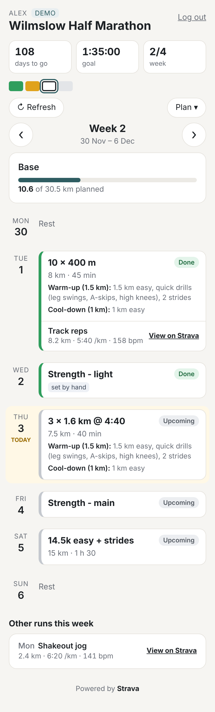

# Wilmslow Half Marathon tracker

A small, mobile-first web app for following a training plan for the **Wilmslow Half
Marathon (21 March 2027)**. Each runner signs in with Strava, uploads their own plan
JSON, and sees their week with each session coloured by how it went. Strava runs are
matched to planned sessions automatically.



## What it does

- **Strava sign-in.** Strava OAuth is the login. Only athletes listed in
  `ALLOWED_ATHLETE_IDS` can sign in.
- **Your own plan.** Each person uploads their own plan JSON. Nobody can see anyone
  else's plan or runs (Strava's rules: an athlete's data is shown only to that
  athlete).
- **Weekly schedule (Mon–Sun).** Sessions are colour-coded: **green** done, **amber**
  partial, **red** missed, **grey** upcoming. A run done on a different day gets a
  "moved to Wed" tag but still counts. Runs before the plan's `start_date` (or
  the first week's Monday if it has none) are ignored.
- **Automatic matching** of Strava runs to sessions (see below). Tap a session to
  correct a guess, swap two runs, mark "no run", or set the status by hand.
- **Strength sessions** are ticked by hand, with the routine's exercises shown in the
  sheet.
- **Season strip.** One square per week: green (≥ 80% complete), amber (≥ 50%), red,
  grey for future weeks. Tap a square to jump to that week.
- **Progress page.** A dial of runs done out of runs planned (with a tick for how many
  were due by today), cumulative distance run against the plan, and the fastest
  intervals, fastest tempo and longest run so far, plus a row of medals counting
  how many half marathons' worth you've run.
- **Race prediction.** On the progress page, below runs done and distance: the half marathon time you'd
  run if you raced today, how far it is from your goal, and a chart of how the
  prediction has moved over the plan. It updates as you add runs (see below).
- **Compare athletes.** From the progress page: every athlete with a plan, side by
  side, with the share of their planned runs done and their cumulative distance over
  time (`lib/compare.ts`). Only first names are shown. Other athletes' data is cached
  for 10 minutes to spare Strava's rate limit. Demo mode adds three demo friends.
- **Ralph.** The app's mascot, a raccoon in a race bib
  (`public/raccoon.svg`; his head is the favicon). He comments on your progress at the
  top of the progress page (`lib/ralph.ts`).
- **Rep pace.** Interval and tempo sessions show the average pace of the reps, with
  each rep's pace, picked out from your Strava laps (`lib/reps.ts`, see below). The
  "Fastest intervals / tempo" records rank sessions by rep pace.
- **Download / upload.** Download the plan with `status` and `actual` filled in, edit
  it elsewhere (e.g. with Claude), and upload it again. Progress is stored by session
  ID, so it survives a re-upload.

### How reps are found

For interval and tempo sessions, the laps of each matched run are fetched and the
work laps picked out:

1. **From the plan.** Each block of the session's `structure` (e.g. 5 × 700 m @ 4:35)
   gives an expected distance and time per rep. A lap is a rep only if it's close to
   both: within 15% of the distance, and no more than 20% slower (or 30% quicker) than
   the target time, so a 700 m warm-up lap doesn't count. The closest laps win, up to
   the planned number of reps. Used when at least half the planned reps are found.
2. **From pace alone,** otherwise (e.g. a tempo lapped as one block): laps of 200 m or
   more within 10% of the fastest lap's pace, provided some laps were clearly slower.

Rep pace is the reps' total time over their total distance. Without laps, a session
just shows its whole-run pace.

### How runs are matched

Only `Run`, `TrailRun` and `VirtualRun` activities count. Within each week:

1. **Pinned runs** (chosen by hand in the app) win, even from another week.
2. **Time trial / race:** every run that day counts, so a parkrun saved as warm-up,
   5k and cool-down is one session.
3. **Long run:** the week's longest remaining run, if it's at least 50% of the
   planned distance and at least 1.15 × the longest other planned run.
4. **Intervals, tempo, easy:** remaining runs are assigned in date order, maximising
   matches and then minimising days moved. Runs under 50% of a session's distance
   don't match it.

A run session is **done** at ≥ 85% of its planned distance (time trials and races
always count as done), otherwise **partial**. Unmatched sessions stay **upcoming**
until the week ends, then become **missed**. Runs that match nothing are listed as
"Other runs this week". The rules live in `lib/matching.ts` and are covered by
`tests/matching.test.ts`.

### How the race prediction works

It's an estimate from your training, not a Strava figure (`lib/prediction.ts`,
covered by `tests/prediction.test.ts`):

1. **Speed:** every run of at least 3 km in the last 8 weeks is scaled to 21.1 km with
   Riegel's formula, _T₂ = T₁ × (D₂ / D₁)^1.06_, using its moving time. The fastest
   result is the prediction, so it's usually set by a parkrun, time trial or tempo.
   (A 20:45 5k gives 1:35:27, in line with the plan's February checkpoint.)
2. **Endurance:** Riegel assumes you're trained for the distance. While your longest
   run in the same 8 weeks is under 16 km, the exponent rises towards 1.09 (reached at
   8 km or less), adding a few minutes. Building the long run brings the prediction
   down even without a fast run.

Runs from the 8 weeks before the plan starts are fetched too, so there's a prediction
from day one. The prediction uses whole-run paces, so a hard session diluted by its
warm-up counts for less than a parkrun.

## Running locally

Requires Node 20 or later.

```bash
npm install
npm run demo        # demo mode on http://localhost:3000
```

**Demo mode** (`DEMO_MODE=1`) needs no Strava app or database: it uses an in-memory
store, a fixture plan (`data/demo-plan.json`) and generated fake runs. Set
`DEMO_TODAY=2026-12-03` (the default) to pretend it's a different day. Demo mode never
switches on in a hosted deployment: it requires that neither `NETLIFY` nor `VERCEL` is
set, and those flags are also baked in at build time.

To run against real Strava and Neon locally, copy `.env.example` to `.env.local`, fill
it in, add `localhost` as the callback domain in your Strava API settings, and run
`npm run dev`.

Other scripts:

| Command               | What it does                                            |
| --------------------- | ------------------------------------------------------- |
| `npm test`            | Unit tests (vitest)                                     |
| `npm run typecheck`   | `tsc --noEmit`                                          |
| `npm run build`       | Production build                                        |
| `npm run format`      | Prettier (print width 88)                               |
| `npm run screenshots` | Playwright screenshots at 390px (start demo mode first) |

## Setup on Netlify (after merging)

The app runs on Netlify's free plan with no extra config: Netlify detects Next.js and
applies its Next.js runtime automatically, so there's no `netlify.toml`.

1. **Netlify:** sign up with GitHub, then **Add new site → Import an existing project →
   GitHub** and pick this repo. Keep the detected build settings and deploy. Note the
   `*.netlify.app` URL. (To choose a nicer name, change it now under **Site
   configuration → Change site name**, because Strava needs the final domain.)
2. **Database:** either
   - add **Netlify's built-in database (Netlify DB)** to the site. It sets
     `NETLIFY_DATABASE_URL`, which the app reads automatically. If Netlify asks you to
     claim the database with a Neon account, do it so the database is kept; or
   - create a free project at **https://neon.com**, copy its connection string and add
     it as `DATABASE_URL` in step 4.

   Tables are created automatically on first use.

3. **https://www.strava.com/settings/api:** create an app.
   - Category: Training. Website: the Netlify URL.
   - Authorization Callback Domain: the bare `*.netlify.app` domain (e.g.
     `wilmslow-half.netlify.app`), without `https://`.
   - Upload an icon, then raise the capacity to 10 athletes.
4. **Netlify → Site configuration → Environment variables:** add the variables below (including `APP_URL`, your main `https://…netlify.app` address),
   then redeploy (**Deploys → Trigger deploy → Deploy site**), because new variables
   only apply to new deploys.
5. Open the app, connect Strava (tick "View data about your private activities"),
   upload the plan and check the matches.
6. Send Rachel the link.

### Environment variables

| Name                   | Notes                                                                                                                                                                   |
| ---------------------- | ----------------------------------------------------------------------------------------------------------------------------------------------------------------------- |
| `STRAVA_CLIENT_ID`     | From the Strava API settings page                                                                                                                                       |
| `STRAVA_CLIENT_SECRET` | From the Strava API settings page                                                                                                                                       |
| `SESSION_SECRET`       | Long random string for signing cookies, e.g. `openssl rand -hex 32`                                                                                                     |
| `ALLOWED_ATHLETE_IDS`  | Comma-separated Strava athlete IDs (the number in your Strava profile URL)                                                                                              |
| `APP_TIMEZONE`         | Default `Europe/London`; decides what "today" is                                                                                                                        |
| `STRAVA_API_BASE`      | Default `https://www.strava.com/api/v3`. Strava's new base URL `https://api-v3.strava.com` arrives on 4 Jan 2027                                                        |
| `DATABASE_URL`         | Neon connection string. Not needed with Netlify DB, which sets `NETLIFY_DATABASE_URL` (also read)                                                                       |
| `APP_URL`              | Your main site address, e.g. `https://wilmslow-half-tracker.netlify.app`. Needed on Netlify so Strava redirects back to it rather than a `main--` branch deploy address |

> **Deploy previews:** Strava only redirects back to the callback domain set in its API
> settings, so sign-in works on the main `*.netlify.app` domain only, not on deploy
> previews or branch deploys (`deploy-preview-1--yoursite.netlify.app` and so on).

## How data is handled

- **Stored:** Strava tokens, your plan, manual overrides (status plus pinned
  activity IDs), and the laps of interval and tempo runs for up to 7 days (Strava's
  caching limit). Nothing else.
- **Not stored:** other activity data. Runs are fetched live from Strava on each load
  (one `GET /athlete/activities` call covers the whole plan). Laps cost one
  `GET /activities/{id}/laps` call per interval or tempo run, at most 40 per load, and
  are cached so each run is fetched at most about once a week.
- Tokens are sent in the `Authorization: Bearer` header and refreshed when within 5
  minutes of expiry. If Strava access is revoked, the app asks you to reconnect; if
  Strava's rate limit is hit, it says so and asks you to try again later.
- The session cookie is httpOnly and HMAC-signed, holding only your athlete ID and an
  expiry (60 days).

## Plan format

See `data/demo-plan.json`. The essentials: a non-empty `weeks` array; each week has
`week`, `week_commencing` (a Monday), `phase` and `sessions`; each session has a
unique, stable `id` (e.g. `w03-thu-tempo`), a `date` (`YYYY-MM-DD`, inside its week),
a `type` (`intervals | tempo | long_run | easy | time_trial | race | strength`) and a
`title`. Any `status` and `actual` fields are ignored on upload because progress is
kept in the database; they are filled in again on download.

Keep session IDs stable when editing the plan: progress is linked by ID. If an upload
drops sessions that have saved progress, the app lists them in a warning.

## Project layout

```
app/                 Next.js App Router pages, components and API routes
  api/auth/*         Strava sign-in, callback and logout
  api/plan           GET downloads the plan with progress, POST uploads a plan
  api/progress       Everything the page needs in one call
  api/compare        Runs done and distance for every athlete with a plan
  api/override       Manual status / pinned runs for a session
lib/matching.ts      Matching rules (pure, unit-tested)
lib/plan.ts          Plan validation and export
lib/stats.ts         Progress page figures (pure, unit-tested)
lib/prediction.ts    Half marathon prediction (pure, unit-tested)
lib/compare.ts       Compare page figures for every athlete
lib/strava.ts        Strava API client
lib/db.ts            Neon Postgres store (and in-memory store for demo mode)
lib/session.ts       Signed session cookie
lib/demo.ts          Demo fixture runs
tests/               vitest unit tests
```
